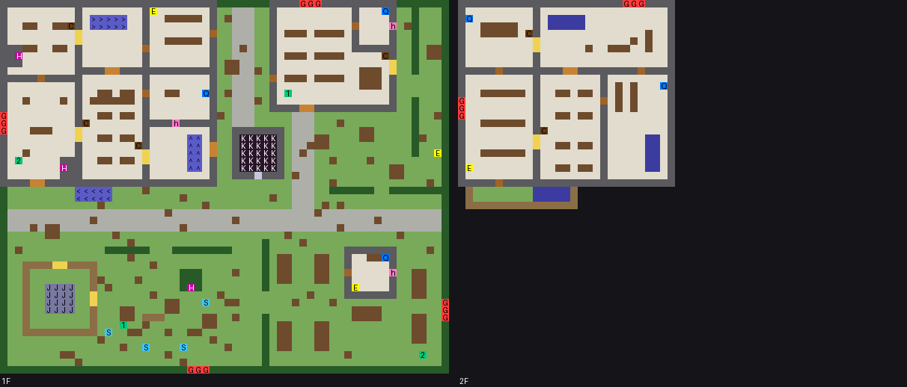

# PvE 固定地圖＋AI 卡住修正：結果和待決定的事（2026-11-21）

## 做了什麼

1. **AI 鬼追人時卡住**：找到三個原因，都修好了（細節見下面「修好的問題」）。
2. **PvE 固定地圖**：
   - 新的讀取器：照文字平面圖蓋（`pve-maps/*.txt`）。
   - **每局開始前重蓋一次**，重新隨機挑大門 2 扇、保全室 2 間、木桶位置；電源從候選裡挑。
   - 支援室內、室外、室內＋室外。
3. **我自己畫的第一張地圖**：`office_park`（夜間辦公園區，室內＋室外，60×50，2 層）。
   - 2 層辦公大樓、1 層倉庫、警衛亭、中間的鬼小屋。
   - 外面有庭院、公園、停車場。
   - 監獄在公園西南角的圍欄院子裡。
   - 陽台有外樓梯，所以 2F 有 3 條路上下。
   - 2 條地下通道，3 個暗格（1 個在樹籬裡）。
4. **工具**：
   - `tools/pve_map_check.py`：檢查地圖、畫成圖。
   - `/gh maps`：列出有哪些地圖。
   - `/gh maptest`：同一張圖用很多種子產生，統計所有隨機結果。
   - `docs/PvE地圖格式.md`：地圖檔格式。
   - `docs/PvE地圖生成prompt.md`：給別的 AI 畫地圖用，已補上室外和這次學到的規則。

## 驗證（測試伺服器，沒有真人）

| 項目 | 結果 |
|---|---|
| `selftest`（4 個種子） | 全部沒有錯誤，AI 尋路 10/10 |
| `maptest` 300 個種子 | 失敗 0；大門組合 6 種，全部不同樓層，兩扇相距 28～65 格；保全室組合 5 種，相距 26～60 格；木桶 33～36 個 |
| AI 卡住（舊地圖，同一組 10 分鐘對局） | 修之前：卡住 7 次、傳送 2 次 → 修之後：卡住 0 次、傳送 0 次 |
| AI 卡住（修完之後，約 16 分鐘的 AI 對局） | 固定地圖 normal 5 分鐘：抓 5 次；hard 5 分鐘：抓 9 次；舊隨機小地圖 normal 4 分鐘：抓 3 次。**卡住 0 次、傳送 0 次** |
| 平衡模擬（3 人、基本鬼，60 局） | 固定地圖：至少 1 人逃出 43%，平均逃出 0.57 人，第一扇門 111 秒開；舊的隨機小地圖：43%、0.65 人、125 秒。兩張差不多 |

## 修好的問題

### AI 卡住

1. **揮拳後的疲勞被當成卡住**：
   - 每揮一次拳會減速 90%（1.5 秒），卡住偵測以為鬼停住了，開始重新找路。
   - 卡住次數又不會歸零，抓幾次人之後累積到第 3 次，就把鬼傳送走。
   - 你看到的「追人時卡住」大部分是這個。
   - 修法：疲勞期間不算卡住；卡住次數 10 秒沒再卡就歸零。
2. **離開路線斜切擦到家具**：
   - 鬼走到路點附近 0.45 格內就算到，再從偏掉的位置斜衝向下一個路點，身體會擦到桌角、木桶。
   - 修法：改成沿著路線走，偏了會拉回線上。
   - 過門時另外對準門板以外的空位（開著的門板會佔掉門框 3/16）。
3. **原版尋路沒關掉**：從原版尋路換回自己的路線時，原版那個還在推，兩邊打架。
4. **卡住偵測誤判**：鬼在做別的事（張望、攻擊）時不檢查，回來後拿很久以前的位置比；減速時也被當成卡住。
   - 修法：改成比「叫它走多遠」和「實際走多遠」；中間有空檔就重新起算。

### 地圖、工具

5. **平衡模擬的 bug**（`tools/simulate.py`）：
   - 大門出口在場地外 2 格。座標是負的（北牆、西牆的大門）或超出範圍時，模擬裡那扇門永遠走不出去。
   - **以前 `docs/平衡模擬.md` 的逃出率都偏低**，已經在那份文件加了更正說明，數字要重跑才準。
6. 樓梯開口旁自動加的欄杆，會把斜對角的格子圍成死角 → 死角一起補欄杆。
7. 選大門時，同一組樓梯的兩條被當成兩組 → 修正。
8. 大門、保全室的組合原本不平均（某一組出現 116/300 次）→ 改成在所有符合條件的組合裡平均抽（現在每組 49～64 次）。

## 需要你決定／之後的方向

1. **戶外比室內亮**：遊戲時間是半夜，戶外天光大約 4；停電時室內只有 1。所以停電後戶外反而比較亮，人類可能都往外跑。可以選：
   - (a) 維持，當成「戶外比較安全但比較遠」的取捨；
   - (b) 戶外的霧調濃一點；
   - (c) 戶外也用燈光控制（要改世界的天空光，比較麻煩）。
2. **路燈停電還亮**：路燈頂端是燈籠（原版光源），不受電源控制。要不要改成跟電源一起亮暗？
3. **木桶在戶外**：戶外也放木桶。要不要戶外換成別的容器外觀（例如木箱、垃圾桶）？
4. **每局重蓋要多等約 3 秒**（蓋 20 萬個方塊，大部分是先清空範圍）。可以接受，或之後改成只換有變的地方。
5. **2F 的大門出口在半空中**：逃出去之後站的平台浮在外面。功能正常，只是看起來怪。
6. **AI 卡住要真人再確認**：測試對局已經 0 次。如果你玩的時候還看到卡住，用 `-Dghosthunt.stuckdebug=true` 開伺服器，log 會印出卡住當下的軌跡和周圍方塊，貼給我。
7. **模擬的鬼不是 AI 鬼**：`simulate.py` 的鬼是照 PvP 規則的簡單追人，沒有 AI 鬼的視野、聽覺、感應。真的要量 PvE 平衡，要嘛真人測，要嘛另外寫一個 AI 鬼版本的模擬。
8. **別的 AI 畫的地圖**：給我之後，我會轉成地圖格式並用檢查工具修。
   - 最常要修的應該是：每行長度、樓梯形狀、暗格後面不是牆、長直線視野。
9. **還沒在真人環境試過**：整張地圖只用 selftest、假逃生者、模擬跑過。建議先進去走一圈，看：
   - 光線、樹籬高度（3 格）、陽台外樓梯；
   - 監獄在戶外院子裡救人順不順。

## 地圖預覽

（`python tools/pve_map_check.py src/main/resources/pve-maps/office_park.txt --png 圖.png` 重畫。紅 G＝大門候選、藍 Q＝保全室候選、黃 E＝電源、粉 h／紫 H＝小洞／暗格、綠數字＝地下通道、深色 K＝鬼房、灰 J＝監獄、淺藍 S＝出生點、藍色區塊＝樓梯。）
