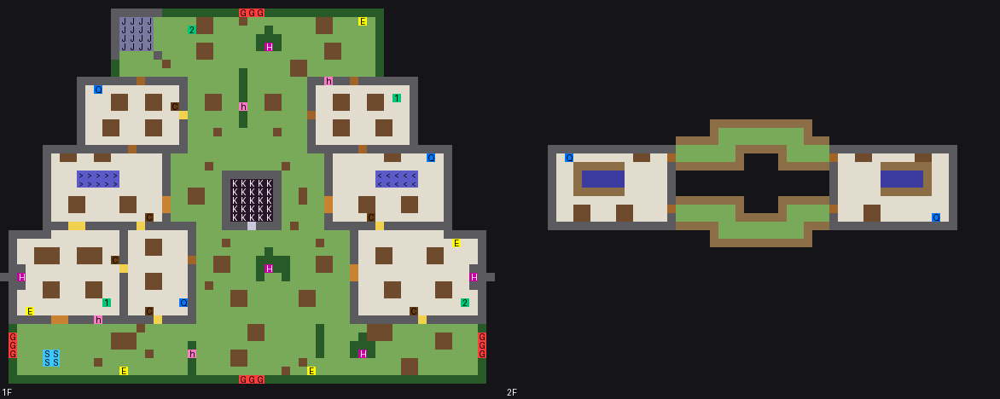
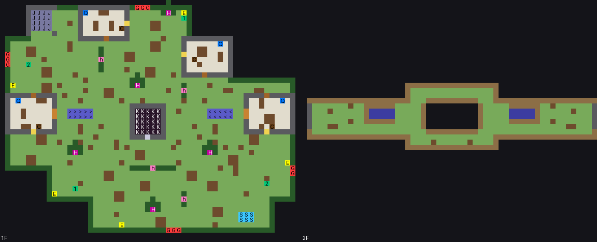

# PvE 新地圖：廢棄水力發電廠、午夜濃霧濱海度假村（2026-11-21）

兩張別的 AI 畫的圖已經轉成地圖格式，放進插件（`/gh build pve hydro_plant`、`/gh build pve seaside_resort`，`/gh maps` 會列出來）。

| | 廢棄水力發電廠 `hydro_plant` | 午夜濃霧濱海度假村 `seaside_resort` |
|---|---|---|
| 類型 | 室內＋室外，58×46，2 層 | 室外（4 間小屋），58×46，2 層 |
| 大門候選 | 4 組（全在 1F） | 4 組（全在 1F） |
| 保全室候選 | 5 間（1F 3、2F 2） | 4 間（全在 1F 小屋） |
| 電源候選 | 5 | 5 |
| 地下通道／小洞／暗格／櫃子 | 2 對／4／5／6 | 2 對／4／5／4 |
| 雙開門（可卡門） | 4 組 | 2 組 |

預覽： 

## 驗證（測試伺服器，沒有真人）

| 項目 | 發電廠 | 度假村 |
|---|---|---|
| 檢查工具 | 錯誤 0 | 錯誤 0（2F 木棧道長視野是故意的） |
| `maptest` 300 個種子 | 失敗 0；大門 6 種組合（每種約 50 次），相距 27～55 格；保全室 3 種；木桶 25 個 | 失敗 0；大門 6 種（每種約 50 次），相距 26～59 格；保全室 5 種；木桶 25 個 |
| `selftest` | 沒有錯誤，AI 尋路 10/10 | 沒有錯誤，AI 尋路 10/10 |
| AI 對局 normal 5 分鐘（3 個假逃生者） | 抓 13 次，卡住 0 | 修之前：抓 9 次，卡住 2 次（沒有傳送）→ 修之後：抓 10 次，卡住 0 |
| AI 對局 hard 5 分鐘 | 抓 11 次，卡住 0 | 修之前：抓 13 次，卡住 0（修之後沒有再跑 hard） |
| 加上音效後的對局 | 3 分鐘，抓 9 次，卡住 0，開局／結束沒有錯誤 | （沒有音效） |

- 抓的次數比 office_park（5 分鐘 5 次）多很多。假逃生者躲得很簡單，所以不代表地圖太難，但這兩張圖的出生點、監獄都離鬼房比較近，真人玩要注意。

## 轉換時改了什麼

轉換程式：`tools/convert_ai_maps.py`（原圖 → 地圖格式，每一處修改都會印出來）。

1. **木桶 `B` 拿掉**：木桶每局隨機（約 25 個），原圖畫的位置不用。
2. **家具 `v` 改成 `x`**：`v` 是往下的樓梯箭頭（發電廠的「閘門閥門座」）。
3. **監獄**：原圖是一間有門的拘留室（牆＋門）。照原樣的話：籠子不會蓋鐵欄杆、被抓的人可以從門走出去、隊友也看不到。
   改成拘留室朝廣場那兩面拆掉，自動蓋成鐵欄杆，靠場地邊緣的兩面牆留著。隊友從廣場那兩側救人。
4. **暗格 `H`**：原圖把 `H` 當成躲藏空間本身，有 3 個畫在最外圈的牆上（後面就是場地外）。
   改成：四周補 1 格空白，躲藏空間後面補牆；躲藏空間旁邊是地面的補成牆／樹籬（發電廠 3 格、度假村 4 格，其中 2 格是溫泉池邊）。
5. **可推倒的櫃子 `C`**：推倒要擋住一個「沒有門板的門口 `O`」。原圖的櫃子放在門 `D`、雙開門 `W` 旁邊。
   - 旁邊是 `D` 的：那扇門改成開口 `O`（發電廠 6 扇、度假村 4 扇）。
   - 旁邊是 `W` 的：櫃子移到同一間房另一個單門旁邊，雙開門留著卡門用（發電廠 3 個、度假村 2 個）。
6. **大門加寬成 3 格**：原圖是 1 格。度假村東邊那扇旁邊是電源，只加寬成 2 格。
7. **2F 對齊**：2F 上面空白的列被讀取器跳過，整層往上跑了 13 列。讀取器（Java 和檢查工具）改成空白列也算。
8. **切長直線**：補 2 個遮蔽物：發電廠西南角大門那排加 1 根柱子、度假村東小屋南邊加 1 棵椰子樹。
9. **路燈**：用銅燈泡＋跟著電源亮暗的光（`| light`），不用燈籠。
10. **2F 地面材質**：新增調色盤 `deck`（2F 的戶外地面）。發電廠天橋是凝灰岩磚，度假村木棧道是橡木板（原本會跟 1F 一樣變成草地）。

## 程式改動

- **大門候選全在同一層時**：只看距離（≥ 25 格），不再要求「靠不同樓梯」。
  - 原本發電廠的上、下兩扇門離兩組樓梯差不多遠，被算成跟東邊那扇同一組，結果每局都挑到西邊那扇（只有 3 種組合）。
  - 現在兩張圖都是 6 種組合、每種約 50/300 次，也不會每局都跳「放寬條件」的警告。
- **監獄外圍可以是牆**：檢查工具原本要求籠子四周都是地面，現在牆可以留著當籠子的一邊。
- **大門讀卡機檢查**：檢查工具改成跟讀取器一樣，只看這排大門的中間那格。

## 需要你決定的事

1. **兩張圖的大門都只在 1F**：畫圖的 AI 把 2F 的大門拿掉了（出去會在半空中，就是上一份報告的第 5 點）。所以這兩張圖每局兩扇大門都在同一層，「大門不同樓層」做不到。要嘛接受；要嘛我在 2F 加一個「出口陽台＋梯子」讓 2F 也能放大門。
2. **度假村的 5 個特殊機制，都還沒做**：
   | 機制 | 內容 | 要改的地方 | 我的看法 |
   |---|---|---|---|
   | 迎賓鈴誘敵 | 敲吧台的鐘，25 格外的涼亭發出廣播聲，鬼被吸引 8 秒，全場冷卻 45 秒 | 地圖格式要能標「鐘」和「聲源」；AI 鬼要有一種全圖都聽得到的聲音 | 好做，也最有趣；救人時很有用 |
   | 球車遠光燈閃盲 | 球車按鈕朝前方 8 格扇形強光，鬼失明＋緩速 3 秒，每台 2 次 | 接手電筒那套「看不到人」＋緩速 | 跟手電筒重複，可以當地圖上的「固定手電筒」 |
   | 溫泉蒸氣閥門 | 噴煙 10 秒，鬼在裡面看不遠，閥門聲 16 格內聽得到 | 霧／視野縮短的區域 | 中等；煙霧對真人鬼也要有效果才公平 |
   | 路燈分區通電 | 每開一個電源，那一區路燈亮 | **跟現在的規則衝突**：現在全場只有 1 個電源，從 `E` 裡隨機挑 | 不建議，除非要改電源規則 |
   | 2F 木棧道腳步聲 | 在 2F 走路（沒蹲），下方 10 格內的鬼會轉頭 | 就是「腳步聲」那個列入考慮的系統 | 等腳步聲系統一起決定 |
3. **度假村幾乎全是戶外**：上一份報告第 1 點（停電時戶外比室內亮）在這張圖影響最大，整張圖停電前後亮度差不多。
4. **2F 視野**：度假村 2F 的木棧道外圍是矮欄杆，整排 56 格看得穿，站在 2F 可以看到整個中庭。原圖說這是故意的（高視野換被堵的風險），我沒改。
5. **門變少了**：為了放櫃子，有些門改成開口。發電廠剩 10 扇單門＋4 組雙開門，度假村剩 4 扇單門＋2 組雙開門。原圖提到「單門要不要能卡」：照目前的規則只有雙開門能卡，我沒改。
6. **房間地板顏色**：原圖給每間房指定了地板，但讀取器是照順序輪流用，所以顏色會用到，只是不一定是原圖指定的那間。要照指定的話，要在地圖格式加「房間 → 地板」的寫法。

## 水力發電廠音效包（你給的 `Hydroelectric_Plant_Audio_Pack.zip`）

做成資源包，插件自己送給玩家：

- **怎麼送**：音檔放在 `resourcepack/`，`./gradlew build` 打包進插件 jar。插件啟動時開一個小網頁伺服器（port 8164），玩家進伺服器時會跳出「要不要下載」，不裝也能玩。
  - 自己電腦測試：不用設定（`localhost`）。
  - 跟朋友連線：`config.yml` 的 `resource-pack.host` 要改成你的公開 IP／網域，port 8164 也要開；或把 zip 放到別的網站，填 `resource-pack.url`。
  - `/gh pack`：重送一次（例如剛才按了不要）。
- **播什麼**（寫在 `hydro_plant.txt` 的 `[sounds]`）：
  | 聲音 | 什麼時候 |
  |---|---|
  | 全場主環境音 | 一直播（小聲當底） |
  | 大壩進水口 | 站在北邊大壩廣場（含監獄） |
  | 渦輪機房 | 西南主渦輪室、東北備用發電機房；2F 觀測室小聲一點 |
  | 高壓變電站 | 中央變電廣場（鬼房那一帶） |
  | 地下檢修通道 | 在地下通道裡 |
  | 遠處金屬異響 | 隨機，45～100 秒一次 |
  | 壓力閥洩壓 | 隨機，70～140 秒一次 |
  | 繼電器跳動 | 開電源、修好電源、停電、鬼關電源 |
- **限制**：
  - 音檔都是立體聲。Minecraft 的立體聲不會依距離變小聲，所以不是「放在某個座標」，而是看玩家站在哪一區，直接在他身上播那一區的聲音（換區就換聲音）。
  - 要真的從某個位置傳出來，要先把音檔轉成單聲道。這台電腦沒有 ffmpeg，我沒轉。
  - 環境音每 30 秒重播一次。頭尾接不接得順我聽不到，README 也說還沒做無縫循環。你進遊戲聽聽看，有接縫的話要剪音檔，或改成淡入淡出。
  - AI 鬼聽不到這些聲音（純氣氛）。
- **還沒驗證**：Minecraft 客戶端接不接受這個資源包、聲音實際聽起來怎樣，要你用遊戲進去才知道。我只確認了網頁伺服器下載得到、sha1 一致，開局、結束沒有錯誤。

## AI 卡住（度假村測出來的新問題，已修）

度假村第一輪 normal 卡住 2 次（沒有傳送，自己恢復了）：
- 兩次都是同一個原因：鬼要去「最後看到人的地方」，但那個點不在 AI 自己的尋路圖上，例如樓梯上、樹叢旁。
- 這時候會改用 Minecraft 原版尋路，但舊的路點沒清掉，原版尋路和自己的路點一起推，鬼就卡在路燈、椰子樹旁邊。
- 修法：改用原版尋路時先把舊路點清掉（`AiGhost.navigate`）。
