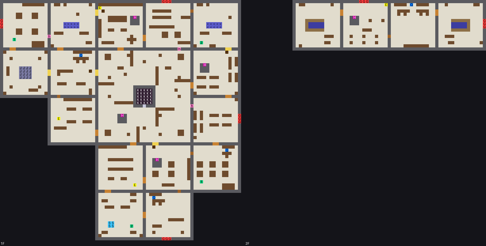
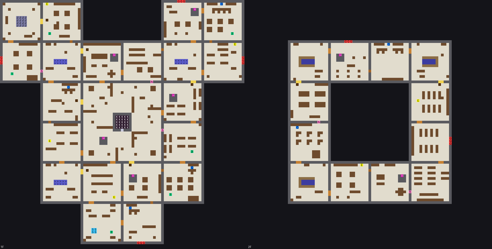

# PvE 主力地圖：午夜購物中心（2026-11-22）

兩張都是別的 AI 用模組化藍圖（巨集圖＋16×16 模組）畫的，原始藍圖在 `docs/pve-maps/blueprints/`。

| | `mall_m`（3～5 人版，**PvE 預設**） | `mall`（原版） |
|---|---|---|
| 大小 | 76×76，2 層 | 91×91，2 層 |
| 大門候選 | 1F 4 組＋2F 2 組 | 1F 4 組＋2F 2 組 |
| 保全室候選／電源候選 | 4／4 | 6／6 |
| 地下通道／小洞／暗格／櫃子 | 2 對／3／5／4 | 3 對／5／7／8 |
| 木桶 | 30 個（地圖自己設） | 36 個 |
| 鬼的尋路圖 | 7,552 格 | 9,088 格 |
| 可見性表（背景建） | 約 1.2 秒、7.6 MB | 約 0.9 秒、12 MB |

預覽： 

## 怎麼做的

1. `tools/assemble_macro_map.py` 照巨集圖把模組拼起來（相鄰模組共用中間那道牆）。兩張圖的接口 0 處不一致。
2. 用專案 skill `ghosthunt-map-check` 檢查拼好的原圖：0 個問題。
3. 用 `tools/pve_map_check.py` 檢查轉好的地圖，修了：
   - **長直線視野**：原圖的檢查把開口 `O` 當成擋視線，所以「幾個模組的開口排成一直線」沒抓到（最長 48 格，從拘留廣場穿過服務台到中庭）。在大廳、中庭補了 2 格高的花台 `p` 切斷（`mall` 9 個、`mall_m` 6 個，位置寫在工具的 `EDITS`）。
   - **電源開關旁邊沒有牆**（有 2～3 個立在店中間）：產生器改成旁邊有 2 格高的家具也能裝拉桿；都沒有就在旁邊補一個鐵方塊配電箱（原本會直接跳過那個候選）。
   - **`mall_m` 的大門組合只有 2 種**：2F 只有北邊一扇大門，而且規則是「不同樓層、靠不同樓梯、相距 25 格以上」。在東北手扶梯迴廊的外牆加了一組 2F 大門（外面是陽台＋梯子）。
   - 檢查工具本身：櫃子 `C` 改成擋視線（2 格高）；終端機、電源旁邊是家具也算靠著東西。
4. **木桶數量**：新增地圖 meta `barrels:`（大地圖照密度會變成 45～70 個，門禁卡很難找）。`mall_m` 30 個、`mall` 36 個，要調就改地圖檔的 `barrels:`。

## 家具（簡化了）

我們的地圖格式只能「由下往上疊方塊」，所以藍圖家具表裡的朝向、活板門面板、展示框、按鈕都做不到，照下面簡化：

| 字母 | 家具 | 實際疊的方塊 |
|---|---|---|
| a | 島型展示櫃 | 去皮白樺木、平滑石英、陶罐 |
| b | 高書架 | 書架、雕紋書架、書架 |
| c | 大理石柱 | 雕紋石英、石英柱×3（接到天花板） |
| d | 櫃檯 | 平滑石英 |
| f | 服飾牆櫃 | 雲杉木板、白羊毛、雲杉木板 |
| g | 圓餐桌 | 白樺柵欄＋壓力板 |
| i | 後廚檯 | 煙燻爐、鐵方塊 |
| k | 倉儲木箱 | 橡木板、去皮橡木、橡木板（原設計用木桶，木桶是遊戲的容器，改掉） |
| l | 立燈 | 深板岩牆、鐵鏈、銅燈泡（跟著電源亮暗） |
| 其他 | | 照家具表的方塊，只取由下往上那一串 |

**`mall_structures.zip` 的結構檔（.nbt）沒用**：
- 結構檔是照藍圖蓋好的固定樣子，可是遊戲每局要重新隨機大門、保全室、木桶，還要蓋地下通道、監獄鐵欄杆、會亮暗的燈、尋路用的石磚樓梯。
- 結構檔裡這些都不一樣：監獄沒有欄杆、大門是鐵方塊、樓梯是石英樓梯、沒有地下通道。
- 所以格局、機關由我們的產生器蓋。
- 之後如果想要結構檔裡那種精緻家具，可以做「產生器蓋完以後，只把結構檔裡家具那幾格貼上來」。

## 測試（測試伺服器，假逃生者）

| 項目 | `mall_m` | `mall` |
|---|---|---|
| `maptest` 300 個種子 | 失敗 0；大門 3 種組合（都是 1F＋2F，相距 53～77 格）；保全室 3 種；木桶 30～35 個 | 失敗 0；大門 5 種（34～81 格）；保全室 7 種；木桶 36～38 個 |
| `selftest` | 沒有錯誤；AI 尋路 10/10；2F 大門外有陽台＋梯子 | 沒有錯誤；AI 尋路 12/12 |
| 每局重蓋 | 約 3 秒 | 約 3 秒 |
| AI 對局（3 個假逃生者，各 5 分鐘） | 普通：抓 10 次、卡住 0；困難：抓 15 次、卡住 0 | 普通：抓 7 次、卡住 1（擦到木桶，已修）→ 重測：抓 10 次、卡住 0 |
| 傳送／例外 | 0／0 | 0／0 |
| AI 每 tick 平均 | 0.12～0.14 ms | 0.12～0.26 ms |
| 第一次接觸（開局後） | 約 59～70 秒 | 約 65～70 秒 |

## 要注意

- 兩張圖都比之前的 PvE 圖大很多（可走的格子大約 2～4 倍）。2～3 人的 PvE 節奏可能偏鬆，要真人玩過才知道；可以調的有木桶數量、AI 的感應間隔（`sense-quiet`）、粒子數。
- 中庭 `CORE` 是一個 783 格的大空間（有展示台、花台切開），檢查工具會提醒「區域偏大」，是設計的一部分。
